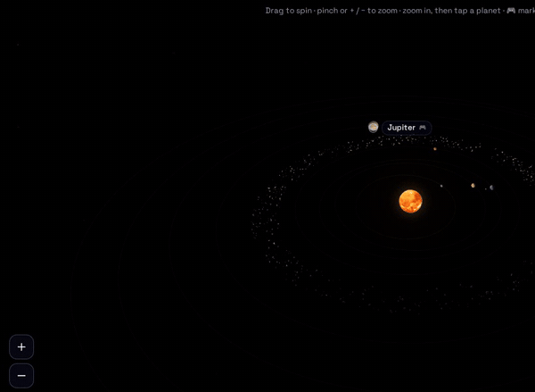

### Hi, I'm Imadh 👋 DevOps Engineer

I build and self-host my own apps on a home server: Docker, CI, monitoring and everything as code.

**Live:** [imad7x.uk](https://imad7x.uk), an interactive 3D solar system and games · [jobs.imad7x.uk](https://jobs.imad7x.uk), 7xjobs, jobs in India straight from company career pages

- [**homelab**](https://github.com/imad7x/homelab): the server as code
- [**imad7x.uk**](https://github.com/imad7x/imad7x.uk) · [**jobs.imad7x.uk**](https://github.com/imad7x/jobs.imad7x.uk): about my two live sites
- [**resume-web**](https://github.com/imad7x/resume-web) · [**updater**](https://github.com/imad7x/updater): small self-hosted apps
- [**lgtv**](https://github.com/imad7x/lgtv) · [**x7-home**](https://github.com/imad7x/x7-home): a webOS TV app and an Android launcher
- 🔒 **finance**, **ipodesk**, **gym**, **health** and more: private, code on request
